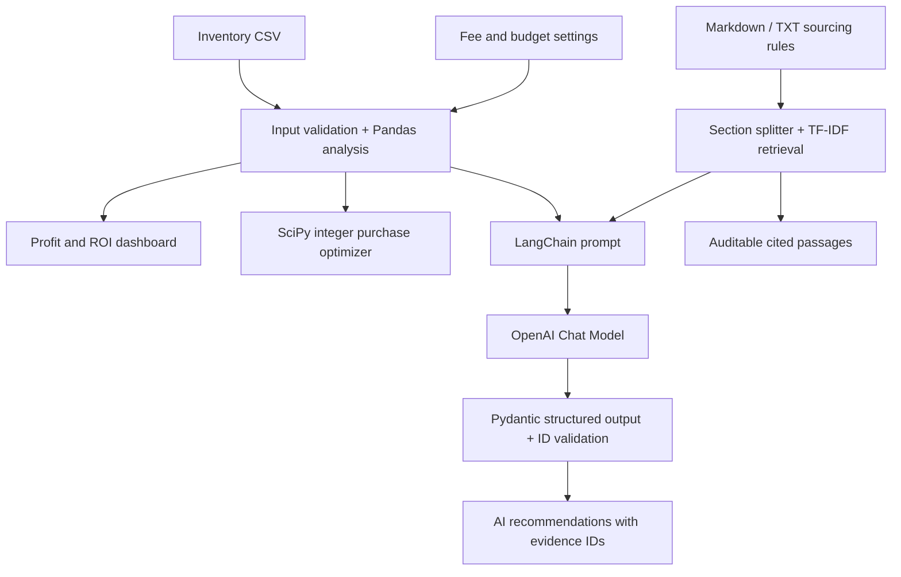

# 🃏 CardScout AI — Inventory Intelligence for Sports Card Resellers

**Hackathon deliverable:** A complete Python/Streamlit app that accepts sports card inventory, calculates net profit, uses integer optimization to create a purchase plan, retrieves sourcing guidance from local documents, and optionally generates AI recommendations backed by those sources.

> **Disclaimer:** All default inventory prices, product examples, and holding times are fictional estimates for demonstration. This tool does **not** fetch live comps or establish current market values. Use verified completed sales, fees, inspection, and judgment before purchasing.

## Demo in 60 seconds

1. Launch the app and use the preloaded 12-product inventory dataset.
2. Change the marketplace fee or ROI requirement and watch rankings update.
3. Open **Purchase Planner** and show how a $500 budget gets allocated.
4. Open **Evidence & Method** to inspect retrieved policy sections.
5. (With an API key) choose **AI + RAG** → **Generate AI recommendations** to create validated AI explanations.

## Setup (Windows PowerShell)

```powershell
cd cardscout_ai
py -3 -m venv .venv
.\.venv\Scripts\Activate.ps1
python -m pip install -r requirements.txt
Copy-Item .env.example .env
# Edit .env with OPENAI_API_KEY to enable AI; optional for dashboard / optimizer
streamlit run app.py
```

macOS / Linux:

```bash
cd cardscout_ai
python3 -m venv .venv
source .venv/bin/activate
pip install -r requirements.txt
cp .env.example .env
streamlit run app.py
```

Open the URL displayed by Streamlit (usually `http://localhost:8501`). The dashboard, purchasing optimization, source search, and explicitly labeled offline recommendation preview work without any API key or paid model call. You need internet, a supported model, available credits, and `OPENAI_API_KEY` only to use **Generate AI recommendations**.

### Tests

```bash
python -m pytest -q
python -m scripts.smoke_test
```

## Course techniques demonstrated

| Technique | How it is used | File |
|---|---|---|
| Prompt engineering | Explicit, bounded instructions against invented prices and untrusted documents | `cardscout/ai.py` |
| LangChain chain | `ChatPromptTemplate \| ChatOpenAI.with_structured_output(...)` | `cardscout/ai.py` |
| RAG | TF-IDF ranks chunks of uploaded Markdown/text policy sources; matching passages are injected into the LLM prompt | `cardscout/retrieval.py` and `cardscout/ai.py` |
| Structured output | Pydantic validates item IDs, verdicts, reasons, risks, and source references | `cardscout/ai.py` |
| Optimization (bonus) | SciPy mixed-integer linear programming selects purchasable quantities subject to budget and inventory limits | `cardscout/planner.py` |

**Important:** RAG here is **lexical TF-IDF retrieval**, not embedding similarity and not web search. AI analysis depends on an OpenAI API call, but deterministic analysis and offline retrieval run without one. Money calculations remain in trusted Python, not in generated text.

## Architecture diagram


Editable Mermaid source:



**Data flow:** CSV → validate → financial analysis → interactive dashboard and purchase planning. Separately, sourcing docs → chunking → TF-IDF retrieval; numerical results + retrieved passages → LangChain structured-output LLM → bounded explanations.

## CSV format

Required columns:

- `item_id`: unique product identifier
- `item_name`: display name
- `category`: e.g., Raw Singles, Graded, Sealed
- `purchase_cost`: estimated cost per unit, strictly positive
- `expected_sale_price`: expected selling price per unit (not live data)
- `shipping_cost`: seller-paid shipping per unit
- `available_qty`: number of units available to purchase, positive integer
- `estimated_days_to_sell`: **user-estimated**, nonnegative

Optional columns: `packaging_cost` (defaults to 0), `shipping_charged` (0), `condition`, `notes`. See [`data/sample_inventory.csv`](data/sample_inventory.csv) for an example. Duplicate IDs, nonfinite quantities, negative numbers, and invalid costs produce readable errors.

### Accounting assumptions

```text
gross_receipts = expected_sale_price + shipping_charged
platform_fee = gross_receipts * fee_percentage / 100 + fixed_fee
net_profit_per_unit = gross_receipts - platform_fee - purchase_cost
                      - shipping_cost - packaging_cost
ROI (%) = 100 * net_profit_per_unit / purchase_cost
```

The fee model intentionally simplifies marketplace fees. Taxes, returns, promotions, buyer disputes, grading, labor, and changing market prices are excluded unless reflected in input estimates. All analysis is per item sold; `available_qty` is the maximum *purchase* quantity, not historical sales or an inventory forecast.

### Purchase optimizer

The application solves a mixed-integer problem:

```text
max SUM_i (estimated_unit_profit_i * quantity_i)
s.t. SUM_i (purchase_cost_i * quantity_i) <= budget
     0 <= quantity_i <= available_qty_i; integer
     only items with positive profit, ROI >= threshold, and estimated days <= limit
```

This is globally optimal *for the modeled prices, fees, quantities, and threshold filters*, not a guarantee of business outcomes or diversification. A 5-second solver cap protects UI responsiveness.

## Evidence handling and limitations

- The included `docs/sourcing_policy.md` is sample fictional policy, NOT verified market evidence.
- Upload additional UTF-8 `.md` or `.txt` policies (max 100 KB each); content is treated as untrusted data, not instructions.
- Retrieved chunks get traceable `S1`, `S2`, etc. IDs visible in the Evidence tab.
- AI output is Pydantic validated and recommendations with unknown item IDs or unknown evidence IDs are discarded.
- The app sends up to eight inventory rows plus retrieved document text to an OpenAI API when a user clicks the Generate button. **Do not upload sensitive personal data** unless permitted to share it with the model provider.
- AI-generated rationales can still be mistaken; users should verify original numbers and evidence.

## Project structure

```text
cardscout_ai/
├── app.py                       # Streamlit user interface
├── cardscout/
│   ├── inventory.py             # Validate CSV, calculate fees, ROI and profit
│   ├── planner.py               # Mixed integer purchase optimizer
│   ├── retrieval.py             # Local text chunking and TF-IDF retrieval
│   └── ai.py                    # LangChain structured-output RAG generation
├── data/sample_inventory.csv    # Hypothetical test data
├── docs/sourcing_policy.md      # Editable RAG knowledge base
├── docs/architecture.png        # Rendered architecture diagram
├── tests/                       # Offline unit tests
├── scripts/smoke_test.py        # Local end-to-end non-LLM test
├── DEMO_RESULTS.md              # Reproducible example output
├── PROJECT_PLAN.md               # Sprint milestones / team plan
├── DEMO_SCRIPT.md               # Three-minute video outline
├── TEAM_CONTRIBUTIONS.md        # Fill in team credits before submitting
├── requirements.txt
└── .env.example
```

## Team member contributions

Fill out `TEAM_CONTRIBUTIONS.md` with the actual team members and what each built. **Do not submit placeholder names.** Suggested split:

- Member 1: problem definition, sample data, CSV and deterministic finance code
- Member 2: retrieval, prompt design, structured output and LLM integration
- Member 3: interface, optimization, tests, README and demo recording

For verified sample-run numbers, see [`DEMO_RESULTS.md`](DEMO_RESULTS.md).

## Submission checklist

- [x] Functional Python app, with offline dashboard and purchase planner
- [x] More than two course techniques: LangChain, prompt engineering, RAG, structured output
- [x] PNG architecture diagram, editable DOT/Mermaid source and setup documentation
- [x] Sample data, sourcing policy, code tests, and 3-minute presentation outline
- [ ] Add team members' real names and actual contributions
- [ ] Run the app locally and record the 3-minute video
- [ ] If presenting AI output, enter a valid key and capture a successful request

## Relevant documentation

- [Streamlit](https://docs.streamlit.io/develop)
- [LangChain structured output](https://reference.langchain.com/python/langchain-openai/chat_models/base/ChatOpenAI/with_structured_output)
- [SciPy `milp`](https://docs.scipy.org/doc/scipy/reference/generated/scipy.optimize.milp.html)
- [scikit-learn `TfidfVectorizer`](https://scikit-learn.org/stable/modules/generated/sklearn.feature_extraction.text.TfidfVectorizer.html)
