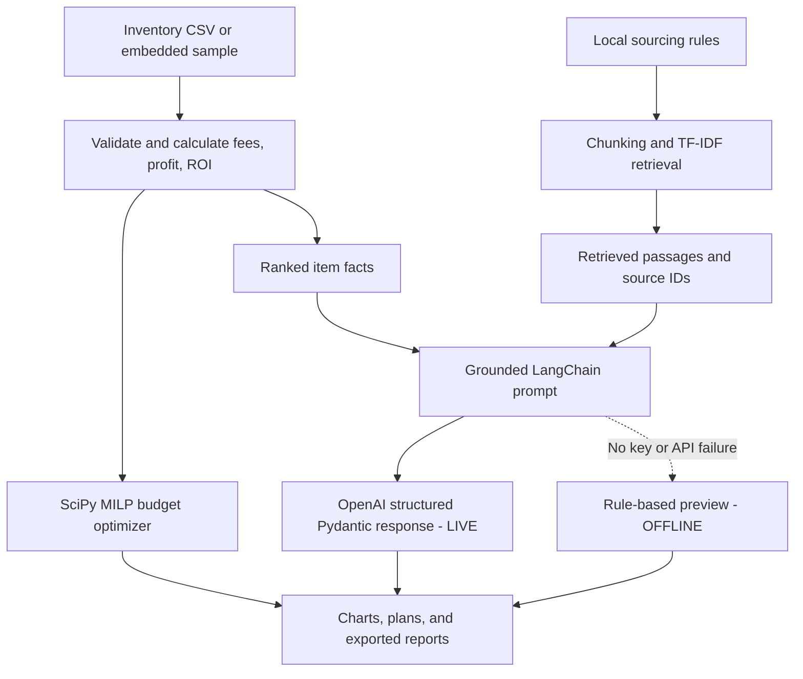

# CardScout AI 🃏

**An AI-assisted sports card inventory analyzer and purchase-planning notebook**  
One-week AI application hackathon | Python / Jupyter Notebook

## Problem and solution

Sports card resellers compare acquisition costs, estimated selling prices, marketplace fees, shipping, inventory availability, and selling time. Reviewing these factors manually is time-consuming and makes it easy to overlook a low-margin purchase.

**CardScout AI** loads an inventory spreadsheet, calculates realistic *estimated* margins, selects affordable purchases under a fixed budget, and explains sourcing risks using a retrieval-augmented AI assistant. It is designed to help resellers evaluate options—not to guarantee future profit.

## Features

| Feature | How it works |
|---|---|
| Inventory analyzer | Validates product data; calculates seller fees, estimated net profit, ROI, and break-even resale prices using Python and pandas. |
| Budget optimizer | Uses SciPy mixed-integer linear programming (MILP) to select whole purchase quantities subject to budget, stock, ROI, and holding-time rules. |
| RAG sourcing assistant | Splits a local sourcing-policy document into passages and retrieves relevant sections using TF-IDF and cosine similarity. |
| AI recommendations | In **LIVE** mode, LangChain and an OpenAI chat model use retrieved evidence and precomputed figures to return Pydantic-validated recommendations. |
| Ask CardScout | Answers a new item-specific question and displays retrieved sources and purchase-verification steps. |
| Market stress test | Recalculates inventory and optimizes purchases following hypothetical resale-price declines or fee increases. |
| Maximum-offer calculator | Computes the highest acquisition price that meets a selected target ROI. |
| Exports and checks | Writes CSV/JSON evidence reports and runs nine core plus five additional demo validation checks. |

### Course techniques demonstrated

- **Retrieval-Augmented Generation (RAG):** retrieving policy passages and passing them into an LLM prompt.
- **LangChain and prompt engineering:** chaining grounded prompts to an OpenAI chat model.
- **Structured output:** Pydantic schemas validate recommendation and research-answer fields, with source IDs checked against retrieved evidence.
- **Additional technique:** SciPy integer optimization makes the budget planning actionable.

The numeric calculations and purchasing optimization happen **in Python**, not in the language model. The AI explains the assumptions, retrieved guidance, and risks.

## Project structure

```text
CardScout_AI_Submission/
├── CardScout_AI_Demo_Enhanced.ipynb  # Main, self-contained application
├── README.md                         # This documentation
├── requirements.txt                  # Python dependencies

# Created automatically when the notebook runs:
cardscout_outputs/
├── inventory_analysis.csv
├── purchase_plan.csv
├── recommendations.json
├── demo_research_trace.json
├── demo_scenario_comparison.csv
├── demo_item_sensitivity.csv
└── demo_max_purchase_offers.csv
```

## Installation and setup

**Requirements:** Python 3.10+ and Jupyter Notebook or JupyterLab. An API key is only required for live LLM-generated recommendations.

1. Download/extract this project and open a terminal in its folder.
2. Install the packages:

   ```bash
   python -m pip install -r requirements.txt
   ```

3. Open Jupyter:

   ```bash
   jupyter lab
   ```

4. Open `CardScout_AI_Demo_Enhanced.ipynb`.
5. In the **Step 1: Imports and user settings** cell, leave `CSV_PATH = None` to use the 12 embedded example products. Set your budget, fee percentage, and minimum ROI as desired.
6. Run **Kernel → Restart Kernel and Run All Cells**.

### Enable real AI responses (optional)

The notebook starts with `ENABLE_LIVE_AI = False`; **offline mode uses rules, not LLM-generated answers**.

For live AI:

1. Set `ENABLE_LIVE_AI = True` in the **Step 1** settings cell.
2. In the next **API key configuration** cell, uncomment this line and run it:

   ```python
   os.environ["OPENAI_API_KEY"] = getpass("Enter OpenAI API key: ")
   ```

   Or create an untracked local `.env` file containing `OPENAI_API_KEY=your_key_here` (the notebook supports `python-dotenv`). **Never upload or commit API keys.**
3. Verify the API-key check prints `OpenAI API key available: True`.
4. Run subsequent notebook cells in order. When a model call succeeds, the recommendation section prints `LIVE LangChain + OpenAI`, and the research tool prints `LIVE — LangChain + OpenAI`.

If the key is missing or the API request fails, the notebook explicitly switches to **OFFLINE** and shows its deterministic preview instead. Live API usage requires a valid account with API access and may incur charges.

### Use your own inventory

Set `CSV_PATH = "my_inventory.csv"` and place your CSV in the notebook's working folder. Required columns:

```text
item_id,item_name,category,purchase_cost,expected_sale_price,shipping_cost,available_qty,estimated_days_to_sell
```

Optional columns: `packaging_cost`, `shipping_charged`, `condition`, `notes`.

To supply your own sourcing policies, set `POLICY_PATH = "my_sourcing_rules.md"` (plain `.md` or `.txt`). The built-in policies are fictional training guidelines.

## Architecture



**Trust and verification:** the assistant may cite only retrieved policy IDs and known product IDs. It is told not to invent actual sales, grades, or market prices. Python's computed financial values remain authoritative.

## Testing

The notebook has **9 automated core checks** and **5 additional demo checks**. They test profit calculations, nonnegative and whole purchase quantities, budget and stock limits, source IDs, scenario results, and purchase-price constraints. Run the section **Quality assurance: deterministic tests** after the earlier cells.

The core notebook can demonstrate the calculations and RAG retrieval without network access. Verify the live AI path on the computer where you will run the notebook.

## Known limitations

- Sample inventory prices and policy passages are **hypothetical**, not live sales data.
- Resale estimates, demand, liquidity, condition, and holding times must be verified independently.
- TF-IDF uses keyword overlap, so retrieval is simpler than embedding-based semantic search.
- Recommendations are decision support, not purchasing guarantees or automated trades.
- This notebook does not connect to eBay or other marketplaces to execute transactions.


---

